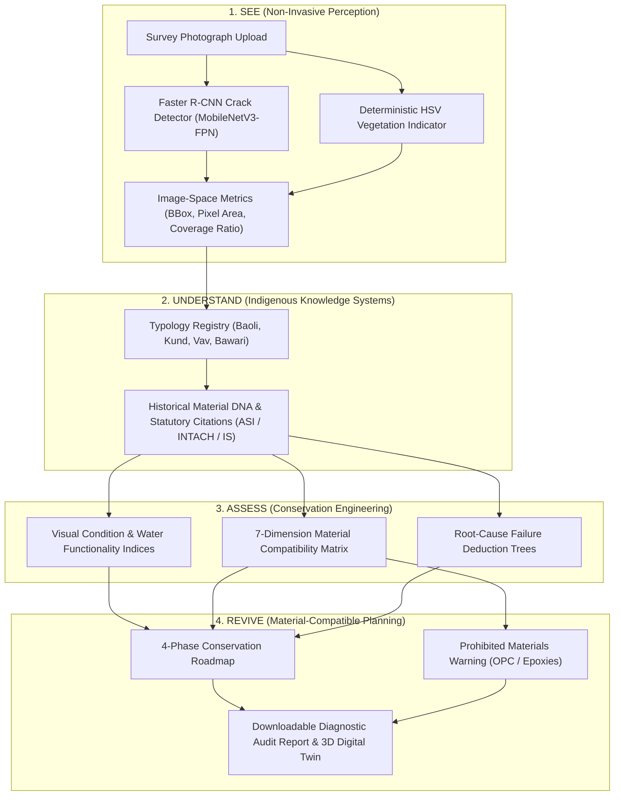

<div align="center">


# Jaldrishti
### AI-Assisted Conservation of Traditional Indian Water Heritage

[](https://www.python.org/)
[](https://fastapi.tiangolo.com/)
[](frontend/)
[](frontend/src/scene/)
[](https://jaldrishti-sigma.vercel.app)
[](tests/)
[](LICENSE)

<br/>

**A sovereign, explainable digital engineering platform connecting non-invasive computer vision, deterministic conservation physics, and Indian Knowledge Systems (IKS) to assess, diagnose, and safeguard historic stepwells, baolis, kunds, and vavs.**

<br/>

[](https://jaldrishti-sigma.vercel.app)
&nbsp;
[](#interactive-api-documentation-swagger-ui)

<br/>

<p align="center">
  <a href="#problem--solution"><b>Problem & Solution</b></a> &nbsp;•&nbsp;
  <a href="#key-implemented-features"><b>Key Features</b></a> &nbsp;•&nbsp;
  <a href="#visual-demonstrations--judge-walkthrough"><b>Visual Demos</b></a> &nbsp;•&nbsp;
  <a href="#how-jaldrishti-works"><b>How It Works</b></a> &nbsp;•&nbsp;
  <a href="#technology-stack"><b>Tech Stack</b></a> &nbsp;•&nbsp;
  <a href="#quickstart--local-setup"><b>Quickstart</b></a> &nbsp;•&nbsp;
  <a href="#interactive-api-documentation-swagger-ui"><b>Swagger API</b></a> &nbsp;•&nbsp;
  <a href="#model-evaluation--datasets"><b>Model Evaluation</b></a> &nbsp;•&nbsp;
  <a href="#limitations--responsible-use"><b>Limitations</b></a> &nbsp;•&nbsp;
  <a href="#future-roadmap"><b>Roadmap</b></a> &nbsp;•&nbsp;
  <a href="#team--license"><b>Team & License</b></a>
</p>

</div>

---

## 🏛️ Problem & Solution

Across the Indian subcontinent, thousands of historic stepwells (*baolis*, *vavs*), stepped catchment tanks (*kunds*, *bawaris*), and percolation reservoirs encapsulate over a millennium of ingenious hydraulic engineering and microclimatic design. Today, these irreplaceable heritage assets face **three critical threats**:

1. **Physical & Biological Degradation:** Invasive woody vegetation roots (*Ficus religiosa/benghalensis*) exert continuous outward mechanical pressure on subterranean retaining walls, while compacted silt deposits choke permeable aquifer recharge beds.
2. **The Ordinary Portland Cement (OPC) Catastrophe:** Well-intentioned but destructive modern repairs routinely point historic lime masonry with rigid, impermeable Portland cement or epoxy coatings. This creates a vapor barrier that traps rising damp; water is forced to evaporate through the stone face rather than the joints, triggering sub-surface salt crystallization (**cryptoflorescence**) that permanently shatters historic stone and brick.
3. **Disappearing Craft Wisdom & Black-Box AI:** Traditional formulations—such as slaked fat lime putty, reactive calcined clay (*surkhi*), and traditional fermented organic admixtures—remain scattered across archaic manuscripts and artisan oral histories. Meanwhile, generic generative AI systems act as unaccountable black boxes that hallucinate recommendations without scientific or statutory grounding.

### The JalDrishti Solution
Jaldrishti replaces guesswork with an **explainable, non-invasive digital diagnostic system**. It strictly decouples visual observation from engineering computation:
- **Computer vision** identifies candidate surface defects and measures damage in image space (pixels and coverage ratios).
- **Deterministic conservation engines** calculate condition scores, evaluate multi-dimensional material compatibility, deduce root-cause failure mechanisms, and formulate phased restoration roadmaps grounded in statutory standards (ASI, INTACH, CPWD, IS, RILEM).

> [!IMPORTANT]
> **Strict Non-Hallucination Safety Boundary:**  
> AI models never invent physical millimeter measurements, estimate unseen structural load capacities, or autonomously approve structural certifications. All engineering indices and compatibility ratings are calculated deterministically.

---

## ⚡ Key Implemented Features

Every feature listed below is verified by code and covered by automated tests (**186 passing tests**):

- **Non-Invasive Vision Defect Extraction (`vision/`):** Candidate crack detection using a fine-tuned Faster R-CNN MobileNetV3-Large FPN pilot (`pilot_v1`) alongside deterministic HSV color-space vegetation filtering. Outputs remain strictly bounded in image space (pixel areas, coverage ratios, connected components).
- **Deterministic Conservation Scoring (`engineering/scoring/`):** Computes normalized Visual Condition Index (0–100) and Water Functionality Index (0–100) based on defect burdens, inlet state, and siltation levels.
- **7-Dimension Material Compatibility Matrix (`engineering/material_compatibility/`):** Evaluates candidate repair mortars against historic substrates across 7 weighted conservation dimensions: Moisture Breathability, Mechanical Sacrificiality, Chemical Inertness, Reversibility, Heritage/IKS alignment, Thermal Dilation, and Visual Harmony. Explicitly flags and prohibits Portland cement and epoxies. Low-confidence substrate inference automatically triggers a safety cap (`acceptable_conditional`).
- **Root-Cause Causal Deduction Trees (`engineering/root_cause/`):** Transparent logic trees mapping observed defect patterns to underlying mechanisms, recommended diagnostic investigations (e.g., phenolphthalein carbonation, salt ion chromatography), and required professional specialties.
- **4-Phase Conservation Roadmap (`engineering/restoration/`):** Automatically formulates prioritized conservation interventions: Phase 1 (Immediate Stabilization), Phase 2 (Hydrological Remediation), Phase 3 (Masonry & IKS Lime Consolidation), Phase 4 (Long-Term Cyclical Monitoring).
- **Indian Knowledge Systems (IKS) Registry (`knowledge/`):** Codified typologies (*Baoli*, *Kund*, *Bawari*, *Vav*) and historical material profiles (*Surkhi*, *Hydraulic Lime*, *Sandstone*, *Quartzite*) backed by 11 statutory and peer-reviewed standards.
- **Interactive Digital Twin & Inspection UI (`frontend/`):** Procedural 3D subterranean stepwell descent built in Three.js, interactive 2D defect inspection canvas, 7-D radar chart, score gauges, and downloadable audit report generator.
- **Hardened Backend API Gateway (`backend/`):** FastAPI service with bounded 25 MB stream ingestion, Pillow decodability verification, server-side Cloudinary CDN isolation, and SQLite metadata persistence.

---

## 📸 Visual Demonstrations & Judge Walkthrough

### 1. Core Philosophy: The See-Understand-Assess-Revive Cycle
Jaldrishti structures heritage diagnostics into four distinct, non-overlapping stages:

<div align="center">
  
</div>

<br/>

### 2. 7-Dimension Material Compatibility Matrix
Jaldrishti's deterministic compatibility engine mathematically proves why modern Portland cement is destructive to historic masonry while traditional hydraulic lime-*surkhi* is protective:

<div align="center">
  
</div>

<br/>

### 3. Genuine Computer Vision Defect Detections
Verified evaluation outputs from the vision pipeline (`vision/demo_assets/`) evaluating masonry test imagery:

| Inspection Subject | Unprocessed Survey Photograph | Vision Inference Overlay | Detection Analysis |
| :---: | :---: | :---: | :--- |
| **Masonry Crack**<br>*(Pilot Test Sample 1)* |  |  | **Confidence:** `0.84`<br>**BBox:** `[3, 298, 646, 768]`<br>**Analysis:** Candidate vertical shear crack across masonry jointing. |
| **Vegetation Intrusion**<br>*(Pilot Test Sample 1)* |  |  | **Indicator:** `Detected`<br>**Coverage Ratio:** `15.18%`<br>**Analysis:** Biological moss and root penetration extracted via HSV filtering. |
| **Sound Historic Masonry**<br>*(Baseline Control 1)* |  |  | **Crack Detected:** `False`<br>**Veg Coverage:** `0.0%`<br>**Analysis:** Intact masonry fabric; baseline established without false alarms. |

<br/>

### 4. Digital Twin 3D Stepwell Descent
The frontend features a procedural Three.js subterranean descent through an illustrative Indian stepwell, modeling daylight penetration, stone courses, and groundwater levels:

<div align="center">
  
  <p><sub><em>Opening frame of procedural 3D stepwell descent (Three.js WebGL viewport). Disclosed in-app as an illustrative architectural model.</em></sub></p>
</div>

<br/>

> [!TIP]
> **1–2 Minute Judge Walkthrough Guide:**
> 1. **Try Online:** Open the live web application at **[jaldrishti-sigma.vercel.app](https://jaldrishti-sigma.vercel.app)**.
> 2. **Explore 3D Descent:** Scroll through the subterranean descent on the homepage to observe daylight attenuation and water table depth.
> 3. **Run One-Click Diagnostic:** Navigate to `/analysis` and click **"Load Development Fixture"** to immediately inspect the complete diagnostic report (2D defect canvas, condition score gauges, 7-D material radar, and 4-phase conservation roadmap) without needing an upload.
> 4. **Try Local API:** Run the backend locally and open **`http://127.0.0.1:8000/docs`** to test endpoints with live parameters.
> 
> *(Visual Recommendation: Direct screenshots of the full Analysis Dashboard and Report Page can be added as supplementary visual assets).*

---

## 🔄 How JalDrishti Works



1. **SEE (दृष्टि):** Field imagery is ingested through a bounded stream. The Faster R-CNN crack pilot proposes candidate crack bounding boxes, while deterministic HSV filtering calculates biological growth coverage. Measurements remain strictly in image-space pixels.
2. **UNDERSTAND (ज्ञान):** Structure typology and inspection notes are cross-referenced with the IKS registry to retrieve architectural characteristics, aquifer recharge patterns, and traditional material profiles.
3. **ASSESS (परीक्षण):** Engineering scoring engines calculate normalized condition scores (0–100); the 7-D compatibility matrix evaluates candidate repair mortars against the substrate stone; root-cause deduction trees identify failure mechanisms with expert review flags.
4. **REVIVE (पुनर्निर्माण):** The platform generates a prioritized 4-phase intervention plan, urgent stabilization directives, and strict warnings against modern impermeable binders.

---

## 💻 Technology Stack

| Layer | Technologies | Role in JalDrishti |
| :--- | :--- | :--- |
| **Frontend & UI** | React 18.3, TypeScript 5.5, Vite 5.4, Tailwind CSS 3.4 | Type-safe, responsive client application and diagnostic dashboard. |
| **Digital Twin** | Three.js 0.185 (Pinned WebGL) | Procedural 3D subterranean stepwell descent with daylight and water modeling. |
| **Backend API** | FastAPI 0.100+, Python 3.10+, Pydantic v2, Uvicorn | High-performance asynchronous REST API gateway and pipeline orchestrator. |
| **Vision & AI** | PyTorch, Torchvision, Ultralytics YOLOv8, OpenCV, Pillow | Faster R-CNN MobileNetV3-Large FPN crack pilot & deterministic HSV vegetation filtering. |
| **Conservation Eng.** | Pure Python 3.10+, JSON Schema (Draft-07) | Deterministic 7-D compatibility matrix, scoring engines, and IKS knowledge lookup. |
| **Storage & Persistence**| Cloudinary Python SDK, SQLite3 | Server-side isolated media storage and local metadata persistence. |
| **Quality Assurance** | pytest 7.4+, httpx 0.24+ | **186 automated tests** (100% passing across backend, vision, engineering, and contracts). |

---

## 🚀 Quickstart & Local Setup

### Prerequisites
- **Python:** `3.10+` (`3.11` recommended)
- **Node.js:** `18.0.0+` (`20+` recommended)
- **Package Managers:** `pip` and `npm`

### 1. Clone & Configure Environment
```bash
git clone https://github.com/NotKrish019/JalDrishti.git
cd JalDrishti

# Copy environment variables template
cp .env.example .env
```

### 2. Backend Setup
```bash
# Create and activate Python virtual environment
python3 -m venv .venv
source .venv/bin/activate  # On Windows: .venv\Scripts\activate

# Install dependencies and package in editable mode
pip install --upgrade pip
pip install -r requirements.txt
pip install -e ".[dev]"
```

### 3. Frontend Setup
```bash
cd frontend
npm install
cd ..
```

### 4. Verify Installation (Automated Test Suite)
```bash
# Run all automated tests via the active virtual environment
pytest -v
# Or directly: .venv/bin/pytest -v
```
*Expected: **186 passed** across all backend, contract, engineering, vision, and frontend tests.*

### 5. Run the Application

#### Terminal 1 — Backend API Service:
```bash
source .venv/bin/activate
uvicorn backend.app.main:app --host 127.0.0.1 --port 8000 --reload
```
- **API Base:** [http://127.0.0.1:8000](http://127.0.0.1:8000)
- **Interactive Swagger Docs:** [http://127.0.0.1:8000/docs](http://127.0.0.1:8000/docs)
- **Alternative ReDoc:** [http://127.0.0.1:8000/redoc](http://127.0.0.1:8000/redoc)

#### Terminal 2 — Frontend Application:
```bash
cd frontend
npm run dev
```
- **Web Application:** [http://localhost:5173](http://localhost:5173)

---

## 📡 Interactive API Documentation (Swagger UI)

JalDrishti includes complete OpenAPI / Swagger UI documentation generated automatically by FastAPI.

### Accessing Swagger UI
- **Local Swagger UI URL:** **[http://127.0.0.1:8000/docs](http://127.0.0.1:8000/docs)**
- **Local ReDoc Alternative:** **[http://127.0.0.1:8000/redoc](http://127.0.0.1:8000/redoc)**
- **OpenAPI JSON Specification:** **[http://127.0.0.1:8000/openapi.json](http://127.0.0.1:8000/openapi.json)**

> [!NOTE]
> **Deployment Architecture Note:**  
> The live deployment on Vercel (`https://jaldrishti-sigma.vercel.app`) serves the frontend SPA and routes API execution endpoints (`/health`, `/analyze`, etc.) to serverless functions. Route `/docs` is reserved for the local FastAPI instance and is accessed via the local server command above.

### Key Verified Endpoints Available for Interactive Testing:

| Method & Route | Subsystem | Request Body | Response Model | Description |
| :--- | :--- | :--- | :--- | :--- |
| `GET /health` | System | None | `HealthResponse` | Verifies service health, version, and readiness. |
| `POST /analyze` | Pipeline | JSON or Multipart | `AnalysisResult` | **Unified end-to-end conservation analysis pipeline.** |
| `POST /vision/analyze` | Vision | JSON or Multipart | `VisionResult` | Extracts and normalizes defect bounding boxes and coverage. |
| `POST /engineering` | Engineering | JSON | `EngineeringResult` | Computes visual condition and water functionality scores. |
| `POST /material-compatibility`| Materials | JSON | `MaterialCompatibilityResult` | Evaluates 7-dimension substrate compatibility matrix. |
| `POST /restore` | Restoration | JSON | `RestorationResult` | Formulates 4-phase conservation roadmap with urgent directives. |
| `GET /knowledge/structures` | Knowledge | None | `List[StructureSummary]` | Catalogs documented water structure typologies (*Baoli*, *Kund*, etc.). |
| `GET /knowledge/sources` | Knowledge | None | `List[SourceRecord]` | Catalogs statutory and peer-reviewed conservation citations. |
| `POST /images/upload` | Images | Multipart File | `ImageUploadResponse` | Validates image size/format and stores to Cloudinary. |
| `GET /images/{id}` | Images | None | `ImageUploadResponse` | Retrieves metadata and responsive delivery URLs. |
| `DELETE /images/{id}` | Images | None | `ImageDeleteResponse` | Deletes image asset with compensating rollback protection. |

Through Swagger UI, reviewers can inspect request and response schemas strictly adhering to [`contracts/`](contracts/), test live payloads, and verify pipeline responses.

---

## 🔬 Model Evaluation & Datasets

### Dataset Provenance & Leakage Prevention
- **Dataset:** Darbhanga Fort brick-masonry crack dataset (`DrabhangaDataset.zip`: 4,259 images, 3,843 YOLO annotation files). Detailed in [`vision/docs/DATASET_AUDIT.md`](vision/docs/DATASET_AUDIT.md).
- **Leakage-Safe Partitioning:** The original public split contained identical duplicate photographs across train/val/test splits. JalDrishti re-split the data using duplicate perceptual hash grouping (seed `1337`):
  - **Train:** 2,822 images (1,055 distinct photographs)
  - **Validation:** 226 distinct photographs
  - **Test (Held-Out):** 226 distinct photographs (197 crack images, 29 background images; 261 annotated crack boxes)

### Evaluated Model: Faster R-CNN MobileNetV3-Large FPN (`pilot_v1`)
Weights tracked at `vision/models/crack_detector_pilot_v1/model.pt` (detailed in [`vision/docs/MODEL_CARD_crack_detector.md`](vision/docs/MODEL_CARD_crack_detector.md)):

| Metric | Validation Set | Held-Out Test Set (95% Bootstrap CI) |
| :--- | :---: | :---: |
| **mAP @ 0.50 IoU** | `0.826` | **`0.855`** `(0.800 – 0.906)` |
| **mAP @ 0.50:0.95 IoU** | `0.613` | **`0.605`** |
| **AP @ 0.75 IoU** | `0.651` | **`0.637`** |
| **Box Precision @ 0.70 threshold** | `0.896` (215 TP / 25 FP) | **`0.909`** `(0.868 – 0.943)` |
| **Box Recall @ 0.70 threshold** | `0.785` (59 missed) | **`0.805`** `(0.753 – 0.857)` |
| **Crack Images Correctly Flagged** | `189 / 197` | **`193 / 197`** (98.0%) |
| **Background Images Correctly Rejected** | `28 / 29` | **`29 / 29`** (100.0%) |
| **Inference Latency (CPU, Apple M2)** | — | **`97 ms`** median per 768×768 image |

### Vegetation Indicator
- Deterministic HSV color-space filter (`scripts/vision/vegetation_indicator.py`) with hue bounds (H: 28–90, S: 30–255, V: 30–255), morphological opening/closing kernels, and component area thresholding ($>50\text{ px}$). This is an explicit color-space heuristic, not a trained neural network.

### Legacy Pilot Clarification
- The earlier YOLOv8n pilot (`vision/models/crack_pilot_yolov8n.pt`) was trained on heuristic pseudo-boxes and is retained strictly for backward compatibility. It is documented in [`vision/docs/MODEL_CARD_crack_pilot_v0.md`](vision/docs/MODEL_CARD_crack_pilot_v0.md) and is superseded by Faster R-CNN `pilot_v1`.

---

## ⚠️ Limitations & Responsible Use

> [!CAUTION]
> **MANDATORY CONSERVATION DISCLAIMER**  
> JalDrishti is an **assistive diagnostic decision-support system**. It is **not** a licensed structural engineering authority, archaeological certification body, or statutory planning agency. AI-generated observations propose candidate regions for professional review and do not replace certified on-site structural inspections.

1. **Non-Invasive Visual Boundaries:** 2D surface photographs cannot detect internal masonry core voids, foundation soil shear failures, deep groundwater table subsidence, or out-of-plane retaining wall bowing.
2. **Dataset Domain Specificity:** The current vision pilot was trained and evaluated specifically on brick masonry from Darbhanga Fort. While resilient on baseline stone imagery, it is not calibrated across all Indian stone varieties and structure typologies.
3. **Mandatory Laboratory Petrography:** Visual substrate identification is probabilistic. Qualified conservators must execute petrographic thin-section analysis, X-ray diffraction (XRD), and acid dissolution tests on physical samples before specifying final mortar mixes.
4. **Provisional Screening Heuristics:** Numerical weights in the 7-dimension material compatibility matrix represent synthesized conservation literature heuristics for preliminary screening. Field trial test panels (minimum 28-day cure) are mandatory prior to full-scale repointing.
5. **Statutory Clearances Required:** All physical interventions on heritage monuments require prior formal statutory clearances from the Archaeological Survey of India (ASI), State Archaeology Directorates, or relevant municipal heritage committees.

---

## 🗺️ Future Roadmap

The following planned extensions are explicitly decoupled from currently implemented capabilities:

- [ ] **Multi-Site & Multi-Stone Dataset Expansion:** Expanding annotated field imagery across diverse Indian stone stepwells (Rajasthan sandstone, Gujarat limestone, Delhi quartzite, Deccan basalt).
- [ ] **Photogrammetric 3D Defect Projection:** Projecting 2D defect segmentations directly onto registered 3D photogrammetric point clouds and mesh scans.
- [ ] **Offline Field Survey Mobile PWA:** Progressive Web App with local WebAssembly/ONNX edge inference and offline geotagged inspection logging.
- [ ] **IoT Sensor Telemetry Integration:** Ingesting live data from piezometric groundwater sensors, ultrasonic pulse velocity (UPV) equipment, and calibrated tell-tale crack displacement gauges.
- [ ] **Regional Language Localization:** Translating diagnostic reports and field workflows into Hindi, Gujarati, Rajasthani, and Marathi for local artisan communities and field staff.

---

## 📚 Technical Subsystem Documentation

For in-depth architectural and mathematical specifications, refer to subsystem documentation:

- [Architecture Specification](docs/architecture.md) — System boundaries and contract design.
- [Conservation Engineering Subsystem](engineering/README.md) — Detailed 7-D compatibility formulas and scoring logic.
- [Vision Subsystem Guide](vision/README.md) — Dataset audit, training procedures, and inference interface.
- [Crack Detector Model Card](vision/docs/MODEL_CARD_crack_detector.md) — Detailed metrics, bootstrap confidence intervals, and evaluation methodology.
- [Dataset Audit Report](vision/docs/DATASET_AUDIT.md) — Duplicate analysis and split validation for Darbhanga Fort imagery.
- [Indian Knowledge Systems Registry](knowledge/README.md) — Typology registry, material profiles, and statutory citations.
- [Backend Subsystem Documentation](backend/README.md) — API orchestration, image ingestion, and security boundaries.

---

## 👥 Team & License

JalDrishti is designed and engineered by **Team NeuralX**:

<div align="center">

<table>
  <tr>
    <td align="center" width="25%">
      <a href="https://github.com/NotKrish019">
        <br/><br/>
        <b>Krish</b>
      </a><br/>
      <sub>AI & Computer Vision Lead</sub>
    </td>
    <td align="center" width="25%">
      <a href="https://github.com/Kirti-799">
        <br/><br/>
        <b>Kirti Antil</b>
      </a><br/>
      <sub>IKS & Conservation Engineering</sub>
    </td>
    <td align="center" width="25%">
      <a href="https://github.com/anikabin-lang">
        <br/><br/>
        <b>Anika Jain</b>
      </a><br/>
      <sub>Frontend & Digital Twin Lead</sub>
    </td>
    <td align="center" width="25%">
      <a href="https://github.com/swastikparmar987">
        <br/><br/>
        <b>Swastik Parmar</b>
      </a><br/>
      <sub>Backend & System Orchestration</sub>
    </td>
  </tr>
</table>

<br/>

<a href="https://github.com/NotKrish019/JalDrishti/graphs/contributors">
  
</a>

</div>

<br/>

### License
JalDrishti is open-source software licensed under the **[MIT License](LICENSE)**.

```bibtex
@software{jaldrishti2026,
  author = {Krish and Antil, Kirti and Jain, Anika and Parmar, Swastik},
  title = {JalDrishti: AI-Assisted Conservation of Traditional Indian Water Heritage},
  year = {2026},
  publisher = {GitHub},
  url = {https://github.com/NotKrish019/JalDrishti}
}
```

<div align="center">
  <sub>Preserving India's timeless hydraulic wisdom through sovereign, transparent digital engineering.</sub><br/>
  <strong>JalDrishti — Connecting Stone, Water, and Science.</strong>
</div>
